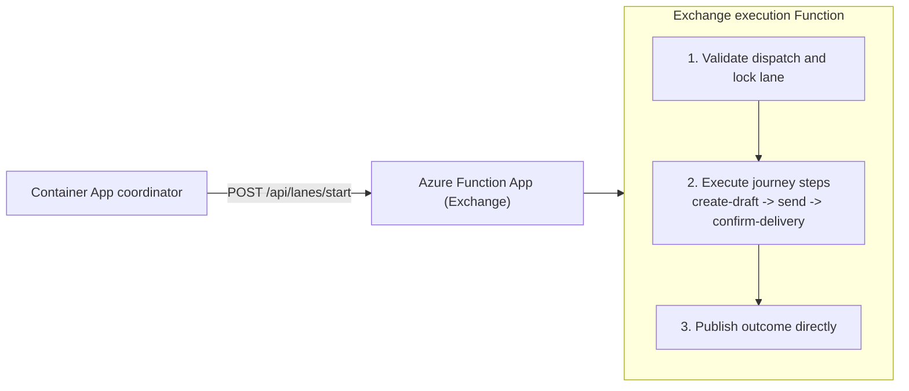

# Monitoring M365 with Azure Monitor Health Models

This repository deploys Azure Monitor Health Models and API-backed Microsoft 365 monitoring from [`monitoring.config.json`](./monitoring.config.json) and its referenced service configuration files.

The health model helps administrators monitor Microsoft 365 in terms of completed tasks rather than isolated API responses. API-backed synthetic journeys provide success and latency signals, and the model connects business steps and journeys to Exchange, Teams, OneDrive, SharePoint Online, and the overall Microsoft 365 experience. This dependency-based view makes observed impact easier to trace and supports experience-level alerts, while Microsoft-reported Service Health remains separate supporting context.

## Monitored services

Each service README includes its completed user journeys,
design rationale, exact Graph endpoints and authentication summary. Setup and
permission requirements are separate for each service:

| Service and health model | Journeys | Authentication and setup |
| --- | --- | --- |
| [Exchange](./synthetic-tests/exchange/README.md) | Four journeys: draft editing and self-mail delivery, attachment integrity, self-reply, private recurring calendar | [Mailbox-scoped Exchange application RBAC](./docs/exchange-permissions.md) |
| [Teams](./synthetic-tests/teams/README.md) | Bot channel conversation and bot-only scheduled meeting | [Managed-identity bots, team-scoped readback and calling](./docs/teams-permissions.md) |
| [OneDrive](./synthetic-tests/onedrive/README.md) | Two journeys: personal-drive roundtrip with versions, app-folder lifecycle | [Selected-folder/AppFolder access](./docs/onedrive-permissions.md) and [folder provisioning](./docs/onedrive-setup.md) |
| [SharePoint Online](./synthetic-tests/sharepoint/README.md) | Two journeys: document-library roundtrip with versions, list-item lifecycle | [Selected-site access and fixture setup](./docs/sharepoint-permissions.md) |

Exchange and OneDrive use dedicated, licensed accounts as resource owners, not
sign-in credentials. Teams uses bot pairs and a pre-created meeting; SharePoint
uses approved site/library/list fixtures. Explicitly selected managed identities
let the checks run unattended without user passwords or refresh tokens.
These journeys measure API persistence, delivery and bot connectivity, not
employee client interfaces or received audio quality.

Azure Functions execute the journeys and publish business-step results. A
Container App only dispatches scheduled cases, keeping scheduling separate from
execution and health reporting.

## Architecture (simple Exchange example)



The coordinator only schedules and dispatches. The Exchange Function executes
the case and publishes the result directly; it is not aggregated in the container.

## Optional Microsoft 365 service endpoints

Synthetic journeys can run without Microsoft-reported context. When approved,
the following **additional Graph GET endpoints** explain provider-reported
incidents, announcements and activity alongside the measured journeys:

| Optional source | Endpoint on `https://graph.microsoft.com` | Provider application permission |
| --- | --- | --- |
| Stable Service Health status | `/v1.0/admin/serviceAnnouncement/healthOverviews` | `ServiceHealth.Read.All` |
| Stable Service Health incidents | `/v1.0/admin/serviceAnnouncement/issues` | `ServiceHealth.Read.All` |
| Message Center announcements | `/v1.0/admin/serviceAnnouncement/messages` | `ServiceMessage.Read.All` |
| Exchange / Teams Service Activity (beta) | `/beta/reports/serviceActivity/{function}(...)` | `ServiceActivity-Exchange.Read.All` / `ServiceActivity-Teams.Read.All` |

Set root `serviceHealth.enabled` and the wanted service's
`config.execution.serviceHealth`, `serviceMessages` or `serviceActivity.enabled`.
Beta additionally requires `deployment.enableBetaServiceActivity: true` and
tenant eligibility; OneDrive and SharePoint collect stable context only.
These sources are optional when configuring a new deployment, but **the
checked-in live configuration explicitly enables stable health/messages for all
four services and beta activity for Exchange/Teams**.

Provider permissions are tenant-wide and belong to a separately approved,
federated read-only application, not the synthetic resource grants. Collection
runs independently and reports only to each service's suppressed **Service
Health** entity: it cannot change synthetic success or Experience rollup.
Unavailable data reports Unknown, not invented availability.
See [provider monitoring](./docs/provider-monitoring.md) for all nine Exchange
and five Teams function names, interval parameters, consent and federation.

## Quick start

1. Complete the [shared Azure prerequisites and foundation setup](./docs/setup.md).
   This includes Function API authentication, not Microsoft 365 consent.
2. From [`synthetic-tests/`](./synthetic-tests/), install dependencies if not already installed:
   ```sh
   npm ci
   ```
3. Follow each selected service's setup guide above for accounts/fixtures,
   resource-scoped grants and generated IDs. One-off provisioning/discovery
   commands launch managed-identity PowerShell jobs; they do not require a
   workstation to impersonate a managed identity. Keep generated IDs in the
   adjacent gitignored [`.env`](./docs/deployment.md#generated-ids-in-env).
4. After access is approved, set `deployment.stage: "all"`, preview and deploy:
   ```sh
   npm run deploy -- --plan
   npm run deploy
   ```

## Configuration

- Root [`monitoring.config.json`](./monitoring.config.json) owns Azure deployment,
  health policy, tenant inventory and optional provider approvals.
- Its `serviceFiles` references [Exchange](./monitoring.exchange.json),
  [Teams](./monitoring.teams.json), [OneDrive](./monitoring.onedrive.json) and
  [SharePoint](./monitoring.sharepoint.json). Each matching `tenants[].config`
  owns that service's identity, targets, scenarios and execution settings.
- Keep [generated per-target ID bindings](./docs/deployment.md#generated-ids-in-env) beside the config.
- `logAnalytics.enabled` selects direct Function health reports (`false`) or
  direct Logs Ingestion API/DCR observations evaluated through Log Analytics
  (`true`); neither path needs Event Hubs or an intermediary ingestion Function.
- Current service settings select 600-second journeys with a 240-second
  whole-journey deadline; these are configurable, not hardcoded limits. Root
  latency becomes Degraded above 15 seconds; Teams channel conversation and its steps
  use the configured 30-second [journey override](./health-model/README.md#latency-thresholds).
  Latency alone never becomes Unhealthy.
  Provider schedules are independent
  (currently 60 seconds). The model uses a 30-minute evaluation window.

## References

- Setup: [docs/setup.md](./docs/setup.md)
- Deployment flow: [docs/deployment.md](./docs/deployment.md)
- Operations and monitoring: [docs/operations.md](./docs/operations.md)
- Architecture diagrams: [docs/architecture.md](./docs/architecture.md)
- Group configuration: [docs/monitoring-groups.md](./docs/monitoring-groups.md)
- Coordinator and execution details: [synthetic-tests/README.md](./synthetic-tests/README.md)
- Model details: [health-model/README.md](./health-model/README.md)
- Optional provider endpoints: [docs/provider-monitoring.md](./docs/provider-monitoring.md)
