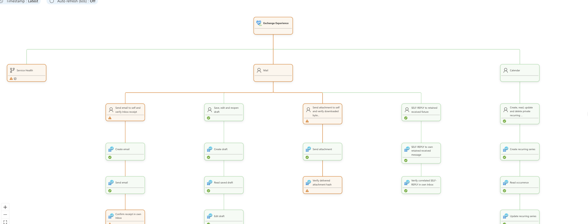

# Monitoring M365 with Azure Monitor Health Models

**A service being available does not necessarily mean a user can complete their task.**

Microsoft 365 can report that Exchange is operational while a particular mailbox cannot send or receive email. An upload request can succeed while reopening the file fails. A Teams message can be accepted without appearing where it is expected.

This example combines **synthetic user journeys** with **Azure Monitor Health Models** to close that visibility gap:

- **Synthetic tests provide evidence:** can a representative task actually be completed?
- **Azure Monitor Health Models provides context:** which action, journey, and service experience does that evidence affect?



*Earlier Exchange view showing two journeys; the current catalog contains six, with separate, impact-suppressed Service Health context.*

## Why synthetic tests?

Provider status and infrastructure metrics are useful, but they do not exercise our approved identities, resources, permissions, and access paths together.

Synthetic tests repeatedly perform a small, controlled workflow against dedicated test resources. They help us:

- **Detect problems proactively**, including when there is little real user traffic.
- **Verify completion, not just API acceptance.** Sending a request is different from confirming delivery, publication, or correct file readback.
- **Identify the failing business action.** Draft creation, sending, and delivery confirmation have different failure modes; identity and cleanup errors remain journey diagnostics.
- **Repeat the observation**, including success and duration, rather than relying on a single manual check.

For example, the core email journey creates a message, sends A→B, confirms actual recipient Inbox delivery, and cleans up. It runs every 60 seconds without reply or attachment work. If sending succeeds but delivery confirmation times out, the evidence preserves that distinction instead of labeling every action as failed.

A failed test is **evidence to investigate, not automatic proof of a Microsoft outage**. Identity permissions, configuration, worker connectivity, and the monitoring system itself can also fail.

## Why Azure Monitor Health Models?

Individual measurements tell us what happened in an attempt. A health model connects those observations to the experiences we care about.

Azure Monitor Health Models lets us:

- **Represent dependencies explicitly:** actions support journeys, journeys support service experiences, and service models contribute to a broader view.
- **Roll up health without losing detail:** start at the overall experience and follow the model to the affected journey or action.
- **Separate different evidence sources:** evaluated synthetic health reports coexist with impact-suppressed Microsoft-reported context.
- **Keep evidence gaps visible:** no observations are not the same as successful observations, and a skipped action is not a failed request.
- **Compose independent models:** Exchange, Teams, and SharePoint can each have their own model while a root model brings their health together.

The model complements logs, metrics, and dashboards; it does not replace detailed investigation or establish the root cause of a failure. Its value is relating evidence to dependencies and potential experience impact.

## Why use them together?

| Source | Question it answers | What it does not establish |
| --- | --- | --- |
| Microsoft 365 Service Health | What does Microsoft report about the subscribed service? | Whether our particular workflow works |
| Synthetic journey | Can our configured identity complete the approved workflow, and where does it fail? | Availability for every user, target, or access path |
| Azure Monitor Health Models | How does that evidence contribute to action, journey, service, and overall experience health? | Root cause or successful notification delivery |
| Worker console diagnostics | What execution, permission, or publication failure needs investigation? | A persistent metrics store or independent failure detection |

Together, they provide a way to distinguish **provider-reported health**, **observed task completion**, and **the health of the experiences built on those tasks**.

```text
Root experience model
|
+-- Exchange model
|   +-- Send/receive email journey -> business-step entities
|   +-- Edit/reopen draft journey -> business-step entities
|   +-- Attachment/hash/reply journey -> business-step entities
|   +-- Distribution-list fanout journey -> business-step entities
|   +-- Recurring calendar journey -> business-step entities
|   `-- Meeting invitation/accept/cancel journey -> business-step entities
+-- Teams model
|   +-- Publish channel message journey -> business-step entities
|   +-- Reply in channel thread journey -> business-step entities
|   `-- Place test calls/wait/hang up -> business-step entities
`-- SharePoint model
    +-- Save/reopen file journey -> business-step entities
    `-- Rename/reopen file journey -> business-step entities
```

Workers aggregate each settled lane cycle's journey/action results and submit health reports directly. Each implemented journey/business step has **External Reports**, plus optional **OpenTelemetry** when Azure export is enabled. The full [model catalog](./health-model/README.md#catalog-versus-modeled-and-live-coverage) gives **five models, 180 entities and 175 relationships**: eleven implemented and 23 explicitly planned/unimplemented journey roots, with 40 implemented and 78 planned business steps. Planned coverage stays Unknown and impact-suppressed, without workers or fabricated reports. Microsoft-reported Service Health stays impact-suppressed under each implemented Experience, with separate children for each provider call. Token acquisition and generic cleanup remain internal; explicit deletion/cancellation/hang-up are business steps.

Reports replace the previous cycle's aggregates; they are not a full metrics store, percentile history, or arbitrary log-query interface. Workers retain no cross-cycle journey history or durable outbox; only optional delegated Teams persists sensitive authentication state in its protected Blob cache. Default bot mode needs no user cache. Console diagnostics remain available for investigation.

**Recommended for enterprise customers:** deploy workers and health models in the customer's Azure subscription associated with the M365 tenant, using customer-owned managed identities and scoped grants. Approved cross-tenant labs can instead use M365 application certificates for Graph, independently of Azure managed-identity reporting. Follow the [short setup instructions](./docs/cross-tenant-access.md); the temporary lab option is not the default recommendation for restrictive customers.

## Optional OpenTelemetry

OTEL is **disabled by default** in [monitoring.config.json](./monitoring.config.json). Direct health reports and console diagnostics remain active whether OTEL is on or off.

- Set `otel` to `{ "enabled": true, "destination": "console" }` to inspect OTEL logs and metrics locally without Azure credentials.
- Select `"destination": "azure-monitor"` to export to workspace-backed Application Insights. The [model templates](./health-model/README.md#optional-otel-signals) provision the optional resources and add journey/step query signals; the [worker templates](./synthetic-tests/infra/README.md#optional-otel-export) mount the connection string as a secret.

OTEL export failures are explicit and do not prevent direct report attempts. Historical OTEL queries use a 15-minute window, while direct reports describe the current cycle. Enabling OTEL adds ingestion/storage/query costs and requires separate live ingestion validation. See the [export contract and limits](./synthetic-tests/utils/README.md#optional-opentelemetry).

## Journey catalog and current coverage

The target catalog describes completed workflows, **not a promise that every family is implemented**. Five families do not mean five API calls. Detailed contracts and planned variants live in the linked guides.

| Service | Target catalog and implemented boundary |
| --- | --- |
| [Exchange](./synthetic-tests/exchange/README.md#journeys-and-scheduling) | Six core journeys implemented: A→B delivery every **60 seconds**; draft, attachment/hash/reply, DL fanout, recurring calendar and meeting invitation/accept/cancel every **300 seconds**. Mail, draft, attachment/reply and DL verified Healthy live; calendar journeys currently blocked by scoped-authorization cache/403. |
| [Teams](./synthetic-tests/teams/README.md#target-catalog-versus-current-implementation) | Five target families: two-bot conversation, answered audio, scheduled meeting, recipient file sharing, Adaptive Card workflow. Current implementation is narrower: one bot posts/replies with Graph observation and signaling-only calls to three configured accounts, every **120 seconds**. Those narrower flows are live verified, not second-bot receipt or media. |
| [SharePoint](./synthetic-tests/sharepoint/README.md#target-catalog-versus-current-implementation) | Five target families: library/folder roundtrip, list CRUD, recipient sharing, versions, search. Current save/read/verify/delete and supporting rename/reopen run every **300 seconds**; approved live targets remain missing. |
| [OneDrive](./synthetic-tests/README.md#onedrive-target-catalog-planned) | Five planned families: user-drive roundtrip, app folder, recipient sharing, versions, search, plus a browser variant. Planned-only model with Unknown/suppressed coverage; no worker, configured cadence or live verification. |

These are **API-backed journeys**, not Outlook/Teams/browser sign-in tests, employee read receipts, Teams media tests, or SharePoint coauthoring tests. A successful test is not tenant-wide availability or a guarantee of every employee's experience.

The checked-in settings enable all supported services and journey scenarios, but use **safe simulation** by default. A controlled live failure-path trial can exercise real authentication/operations before the test resources work: observed failures make journeys Unhealthy, not artificially healthy. Successful journeys, scoped permissions, and end-to-end notifications still require validation. See the [shared worker deployment guide](./synthetic-tests/infra/README.md) for hosting and rollout.

Selected live Teams calls recur alongside messaging at the Teams cadence. Application
`Calls.Initiate.All` requires administrator approval on the **bot** identity, not the Graph observer; its
tenant-wide permission is constrained in this worker by the root individual-user
allowlist. Healthy calling means successful placement, configured wait and verified
hang-up—not proof that a recipient rang, received or answered the call, employee
sign-in, or media quality. Actual API execution/report ingestion and human-observed
notifications remain separate evidence. See the
[calling setup and exact endpoints](./synthetic-tests/teams/README.md#individual-test-user-calls).

The [recorded live baseline](./docs/deployment.md#deployment-status-and-order) contains
execution and health-ingestion evidence and remaining deployment gaps. Implemented,
live verified, and planned coverage are distinct; production reliability gates remain
incomplete. Successful API journeys do not establish employee UI experience or
end-to-end alert delivery. OutlookWeb, TeamsWeb and browser file-upload variants remain planned.

Provider lanes are separate from user journeys: stable Service Health and the five
Exchange/five Teams beta activity functions use independently configured **300-second**
provider cadence in existing workers. Direct provider reports are suppressed supporting
context, counts stay diagnostic unless thresholds are configured, and OTEL is optional.
Beta collection currently receives 403; unavailable data is never fabricated Healthy.
See [provider monitoring](./docs/provider-monitoring.md).

## How to use this example

### 1. Update the project configuration

Edit [monitoring.config.json](./monitoring.config.json), or keep a private copy outside source control:

| What to update | Where |
| --- | --- |
| Services to monitor | `services.exchange.enabled`, `services.teams.enabled`, `services.sharepoint.enabled` |
| Journeys to run | Each service's `scenarios` switches |
| Dedicated mailbox addresses | `services.exchange.targets[].mailbox` |
| Approved Teams messaging resources | `services.teams.targets[]`: tenant, team, standard channel, Bot Connector service URL; userPrincipalName only for optional delegated mode |
| Approved individual call accounts | `services.teams.callTargets[]`: unique test alias `id`, `tenantId`, `callUserId` (user object UUID); three targets in the sample, no repeated channel metadata |
| Approved SharePoint resources | `services.sharepoint.targets[]`: site, drive, and folder IDs |
| Health-report destination and policy | `healthModel`: replace the subscription placeholder and confirm resource group, model name, thresholds, and report TTL |
| Optional OTEL export | `otel.enabled` and `otel.destination`; disabled by default |

All supported services/scenarios are selected by default. Target placeholders are not provisioned resources. Keep credentials, certificates, and connection strings out of configuration files and source control.

### 2. Adjust service-specific behavior

The [Exchange](./synthetic-tests/exchange/config.json), [Teams](./synthetic-tests/teams/config.json), and [SharePoint](./synthetic-tests/sharepoint/config.json) files contain **only service-specific settings**: independent cadence, timeout, simulation/live mode, authentication, cohort, and optional provider collection. Selection, targets, and report policy are configured **only at the root**, not duplicated in these files.

The service config's `scenario` chooses a deterministic simulation outcome; root `scenarios` chooses which user journey to monitor.

Teams defaults to `teamsAuthentication: "bot"` and `botAuthentication: "managed-identity"`:
follow the [short bot setup](./synthetic-tests/teams/README.md#primary-setup-unattended-bot).
The same-tenant installed bot uses an explicitly selected UAMI without user MFA,
refresh tokens or user-cache storage. This measures bot APIs, not employee sign-in/UI.
Team-scoped Graph readback uses a separate Entra application with managed-identity
federation; set service `teamsReadbackClientId` and the matching manifest identity
as described in the bot guide. Provider collection and ARM health reporting remain independent.
Optional `teamsAuthentication: "user-delegated"` supports all selected test users
with isolated credentials/cache partitions and [human bootstrap](./docs/teams-user-bootstrap.md).
Reports remain journey/action aggregates, not per-account signal inventories.

Teams also selects `call-test-user` by default. Approve the dedicated test users,
bot application `Calls.Initiate.All` and [Teams-only authenticated HTTPS callback](./synthetic-tests/teams/README.md#individual-test-user-calls).
Keep that root scenario `false` for messaging-only rollout. No user tokens or
runtime meeting-creation/admin rights are used for calls. Validate each deployment's
actual API execution and report ingestion before relying on it.

All selected journeys run in the same product worker; enabling another journey does not add another Container App. Reusable independent execution lanes schedule Exchange mail every 60 seconds and its other five journey families every 300 seconds. Optional service-owned `executionLanes` sets lane cadence/deadlines; root Exchange targets explicitly name A/B participants and distribution-list expected recipients. See [Exchange setup, exact APIs and coverage](./synthetic-tests/exchange/README.md). Targets/journeys run concurrently, business steps sequentially; timeouts count as failed attempts, while dependent skipped actions do not. A slow lane cannot hold another lane's publication.

The live service examples enable stable Service Health independently of journey setup. A separate provider lane inside each container defaults to 300 seconds (`providerIntervalSeconds`). Approved overview states report 100 healthy, 50 degraded, 0 interruption on suppressed Service Health context; failed/missing/unapproved states are Unknown. Optional beta collects all five approved Exchange/Teams functions; explicit customer thresholds may publish direct context reports, while counts and Teams percentages otherwise remain diagnostics. Neither alters synthetic or Experience health, and Log Analytics is not required. See [provider setup, permissions, endpoints and beta deployment flag](./docs/provider-monitoring.md).

### 3. Run a safe simulation

With Node.js 22 or 24, run from the repository root:

```sh
npm --prefix synthetic-tests ci
npm --prefix synthetic-tests run exchange -- --once
npm --prefix synthetic-tests run teams -- --once
npm --prefix synthetic-tests run sharepoint -- --once
```

These defaults make no Microsoft 365 or Azure calls. Inspect result records and `health-report-preview` output. Each command runs only its selected service; omit `--once` to repeat on that service's cadence. For a private root config, append `--project-config /absolute/path/monitoring.config.json`.

### 4. Prepare and validate live monitoring

Establish the selected [health models](./health-model/README.md), obtain dedicated test resources, and authorize the service identity for both the Microsoft 365 journey and health-report ingestion. Update root targets/destination, select an approved live service file through `configFile`, and explicitly set `ENABLE_LIVE_M365=true`. Prove one live cycle before enabling recurrence or hosting independent workers.

Direct health reports update separate journey and business-step entities through **External Reports**, independently of optional OTEL. Token acquisition and cleanup remain internal and are not published as journey steps. Follow the [administrator setup](./synthetic-tests/README.md#administrator-setup-enable-authentication-and-live-tests) and [deployment guide](./docs/deployment.md); selecting live mode does not grant permissions or deploy resources.

## Further guidance

- [Project configuration](./monitoring.config.json): select services, scenarios, accounts/targets, and report policy.
- [Synthetic test guide](./synthetic-tests/README.md): run safely, configure workers, and understand journey coverage.
- [Health model guide](./health-model/README.md): model composition, signals, aggregation, and deployment.
- [Deployment guide](./docs/deployment.md): hosting, identities, permission boundaries, and rollout.
- [Operations guide](./docs/operations.md): report freshness, monitoring failures, notifications, and production acceptance.
- [Teams/Exchange action catalog](./docs/m365-automation-capabilities.md): implemented and possible journeys, permissions and coverage limits.

Independent monitoring is essential: a stopped worker or broken reporting path must not be mistaken for a healthy service. Neither a health report nor a model state is, by itself, an alert-delivery system.
