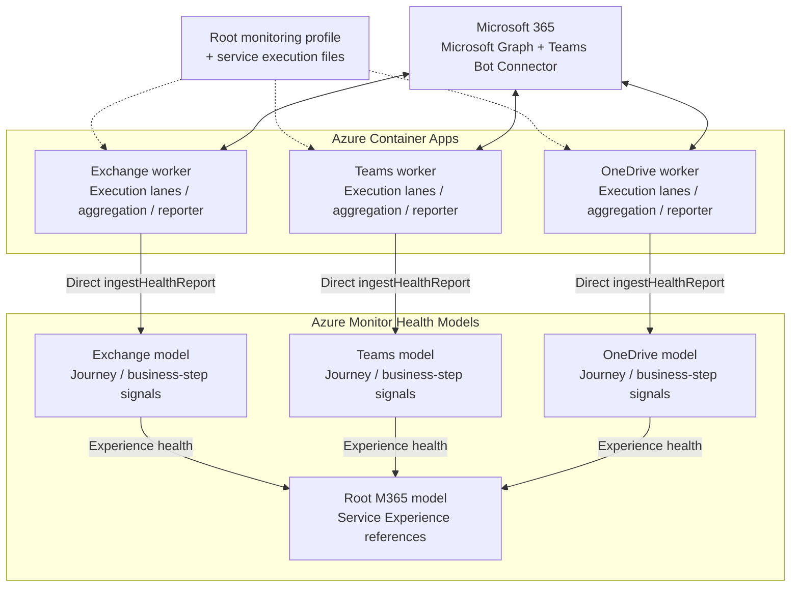

# Monitoring M365 with Azure Monitor Health Models

**A service being available does not mean a representative task can finish.**
These API-backed synthetic journeys produce completion evidence; Azure Monitor
Health Models shows which business step, journey and service that evidence affects.
Microsoft-reported Service Health supplies separate supporting context, not a
substitute for a successful synthetic test.


## Supported journeys

Only executable workflows are selectable. Implemented code and passing source
tests do **not** establish live authorization, successful tenant operations,
ingested health reports or notification delivery. See
[dated deployment evidence](./docs/deployment.md#deployment-status-and-order).

| Service | Root scenario | Completion evidence | Default cadence |
| --- | --- | --- | --- |
| Exchange | `send-receive-mail` | Send A→B and verify B's Inbox delivery | 60 seconds |
| Exchange | `edit-reopen-draft` | Create, read, edit, reopen/verify and delete a draft | 300 seconds |
| Exchange | `attachment-mail` | Send A→B and verify the downloaded attachment hash | 300 seconds |
| Exchange | `reply-mail` | Reply B→A to a retained received message and verify transport correlation | 300 seconds |
| Exchange | `distribution-list-mail` | Verify every configured expected recipient | 300 seconds |
| Exchange | `recurring-calendar` | Create a series, verify/update occurrences, delete and verify removal | 300 seconds |
| Exchange | `meeting-invitation` | Invite, verify attendee calendar, accept, observe acceptance, cancel | 300 seconds |
| Teams | `channel-conversation` | One selected bot posts a root and reply; Graph verifies both authors and correlations | 120 seconds |
| Teams | `scheduled-meeting` | Two managed-identity bots join one meeting, establish both calls, verify metadata/rosters and leave | 120 seconds |
| OneDrive | `user-drive-roundtrip` | Create nested folder/file, enumerate/download/hash, delete and verify absence | 300 seconds |
| OneDrive | `app-folder-lifecycle` | Write/read/update/read app data in a new cycle-owned folder, then delete it | 300 seconds |
| OneDrive | `document-versions` | Update a file and verify actual prior-version bytes; optional downloaded-byte restore | 300 seconds |

These are not browser/desktop, employee sign-in or sync-client tests. Teams
readback does not prove a second bot received a message; meeting connectivity
does not prove received audio or bidirectional quality. See
[quality options and limits](./synthetic-tests/teams/README.md#meeting-and-audio-quality-options).
An opt-in hosted-audio feasibility test can play a synthetic clip and inspect
delayed call records without adding an audio journey or placeholder quality
entities; only actual returned measurements can be published.
SharePoint, P2P audio, Adaptive Card interactions, file
sharing and search prototypes are not part of this project.

Details: [Exchange](./synthetic-tests/exchange/README.md),
[Teams](./synthetic-tests/teams/README.md),
[OneDrive](./synthetic-tests/onedrive/README.md).

## Start safely

Requires Node.js 22 or 24 and npm. All Node tooling is under `synthetic-tests/`.

```sh
cd synthetic-tests
npm ci
npm run exchange -- --once
npm run teams -- --once
npm run onedrive -- --once
```

Checked-in service files use **simulation**: labeled console results and health
report previews, with no live Microsoft 365 operations or Azure ingestion.
Remove `--once` to repeat independently on that service's execution lanes.

## Configure and enable real execution

1. Copy [monitoring.config.json](./monitoring.config.json) to a private profile.
   Set the Azure destination and approved resources. It alone owns service/scenario
   selection, account/target lists and report thresholds/TTL. All supported scenarios
   are enabled by default; remove obsolete service/scenario keys during migration.
2. Each root `configFile` points to a separate service-owned execution file,
   relative to the root profile's directory. Set mode, cadence/deadlines, independent
   `executionLanes`, authentication and optional provider collection there—not a
   duplicate target list or selection switch.
3. Establish the [health models](./health-model/README.md#apply-and-migrate)
   before the [Container Apps workers](./synthetic-tests/infra/README.md).
4. Obtain administrator-approved [access](./docs/cross-tenant-access.md).
   Hosted identities are explicitly selected UAMIs. Teams participants are bots,
   never employee tokens; Exchange retains an explicit certificate option.
5. Select `mode: "live"` and independently set `ENABLE_LIVE_M365=true`.
   [Provision the retained Exchange reply fixture](./synthetic-tests/exchange/README.md#provision-and-test-attachment-and-reply-separately)
   before selecting reply execution in hosted workers.
   Run one real cycle first; inspect operations, cleanup, accepted reports and
   service/root propagation. Missing OneDrive folder IDs/grants fail honestly,
   never by publishing simulated Healthy results.

## Worker architecture

The diagram shows the **live** data path with all three services selected.
Each worker has its own Container App and managed identity. The
[shared runtime](./synthetic-tests/utils/README.md), including scheduling,
aggregation and reporting, runs inside each worker, not as a separate service.



1. **Execute:** the root profile selects journeys and targets; service files set
   lane cadences and deadlines. Lanes run concurrently without overlapping
   themselves or replaying missed slots. Each synthetic lane finishes its attempts
   before reporting that cycle.
2. **Publish:** the in-process [reporter](./synthetic-tests/utils/src/health-reports.ts)
   aggregates journey and executed-step results, then sends HTTPS `POST`
   `ingestHealthReport` requests to existing entities in
   `<healthModel.name>-<service>`. The worker's selected managed identity has
   ingest-only access to that service model; Microsoft 365 API grants are separate.
3. **Evaluate:** reports update **External Reports** signals. Native model
   dependencies roll business-step and journey health into the service Experience,
   then into the root model through service references. Opt-in provider lanes
   report separately to that service model's suppressed Service Health entity,
   without affecting synthetic health or Experience rollup.

Console diagnostics are always emitted. Optional in-process OpenTelemetry is a
parallel export, not a prerequisite for direct health-report ingestion.

## How health is reported

Three independent Container Apps run stateless cycles and publish aggregated
journey/action **External Reports** directly. Each attempt contributes success
**1 or 0** and a measured duration; executed actions are measured separately.
Skipped actions are not failed requests. Authentication and compensating cleanup
remain internal, while deliberate deletion/cancellation/departure are business steps.
There are no per-target signal inventories or durable result/outbox state.

The default selection creates **four models**: a root model and one for each
service. The [shared catalogue](./synthetic-tests/utils/README.md#config) defines
executable journeys and business steps, with Exchange grouped under **Mail** and
**Calendar**.
Existing deployed OneDrive `onedrive-planned-*` IDs are
preserved solely for ingestion continuity; there is no planned-journey catalog.

Service Health requires an explicit root opt-in:

```json
"serviceHealth": { "enabled": true }
```

Omitted or `false` means no Service Health entities, collection or provider reports.
Enabling it adds a supporting entity and relationship to each selected service.
The configuration's `$comment` explains permissions and advanced-monitoring eligibility;
stable Service Health does not require the advanced feature's license minimum.

When opted in, all three services can collect stable Service Health on independent
provider lanes, initially every 300 seconds. Exchange and Teams additionally
support five approved beta activity functions each; OneDrive has no beta collector.
Each product's single suppressed Service Health entity cannot change synthetic metrics or
Experience rollup. Beta collection requires separate explicit approval.
Unavailable sources publish **no health reports**; collection failures remain
diagnostic-only. Observed Service Health statuses map to 100/50/0 availability.
Root-configured [OpenTelemetry](./health-model/README.md#optional-otel-signals)
is optional and disabled by default; no separate telemetry worker is needed.

## Guides and acceptance

- [Runtime configuration, validation and local usage](./synthetic-tests/README.md)
- [Model topology, report semantics and migration](./health-model/README.md)
- [Provider permissions, endpoints and mappings](./docs/provider-monitoring.md)
- [Hosting and rollout](./synthetic-tests/infra/README.md)
- [Operations and enterprise reliability gates](./docs/operations.md)

Deployment readiness and report TTL are not monitoring-reliability guarantees.
Independently detect stopped/stalled workers, failed ingestion and broken alerts,
and verify notifications end to end before operational acceptance.
