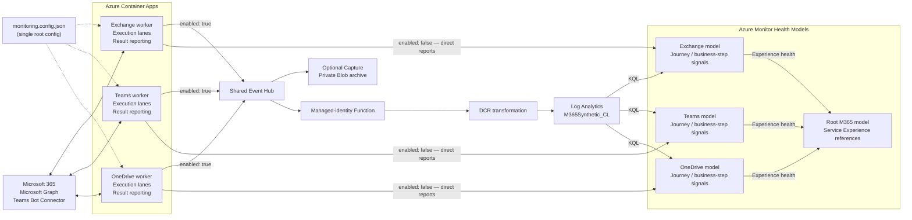

# Monitoring M365 with Azure Monitor Health Models

**A service being available does not mean a representative task can finish.**
These API-backed synthetic journeys produce completion evidence; Azure Monitor
Health Models shows which business step, journey and service that evidence affects.
Microsoft-reported Service Health supplies separate supporting context, not a
substitute for a successful synthetic test.


## Supported journeys

Only executable workflows are selectable. Implemented code and source
validation do **not** establish live authorization, successful tenant operations,
ingested health reports or notification delivery. See
[dated deployment evidence](./docs/deployment.md#deployment-status-and-order).

| Service | Root scenario | Completion evidence | Checked-in cadence |
| --- | --- | --- | --- |
| Exchange | `send-receive-mail` | Send to self and verify own Inbox receipt | Aligned minute |
| Exchange | `edit-reopen-draft` | Create, read, edit, reopen/verify and delete own draft | Aligned minute |
| Exchange | `attachment-mail` | Send to self and verify downloaded attachment bytes/hash | Aligned minute |
| Exchange | `reply-mail` | Explicit SELF-REPLY to a retained received self-addressed fixture; verify transport correlation | Aligned minute |
| Exchange | `recurring-calendar` | Create/read/update/delete own private recurring series, without attendees | Aligned minute |
| Teams | `channel-conversation` | One selected bot posts a root and reply; Graph verifies both authors and correlations | 120 seconds |
| Teams | `scheduled-meeting` | Two managed-identity bots join one meeting, establish both calls, verify metadata/rosters and leave | 120 seconds |
| OneDrive | `user-drive-roundtrip` | Create nested folder/file, enumerate/download/hash, delete and verify absence | 300 seconds |
| OneDrive | `app-folder-lifecycle` | Write/read/update/read app data in a new cycle-owned folder, then delete it | 300 seconds |
| OneDrive | `document-versions` | Update a file and verify actual prior-version bytes; optional downloaded-byte restore | 300 seconds |

Details: [Exchange](./synthetic-tests/exchange/README.md),
[Teams](./synthetic-tests/teams/README.md),
[OneDrive](./synthetic-tests/onedrive/README.md).

## Set up

Follow the separate **[setup guide](./docs/setup.md)** for prerequisites, creating
and licensing Microsoft 365 test accounts, configuring the project, granting
access, generating required service IDs and deploying.

The only maintained configuration is
[monitoring.config.json](./monitoring.config.json): tenants, accounts and targets,
scenarios, execution settings, deployment and [user groups](./docs/monitoring-groups.md).
Generated IDs go to a gitignored `.env` beside it; secrets do not belong in either file.

**Review before running:** the checked-in configuration belongs to a real test
tenant and enables live probes, Azure Monitor export, stable Service Health,
Exchange beta Service Activity and root health alerts. It is not an offline example.

After deployment, verify fresh journey reports, roll-up and notifications end to
end. A finished deployment proves only the rollout; see
[operations](./docs/operations.md#enterprise-reliability-acceptance-gate).

## Worker architecture

The diagram shows the **live** data path with all three services selected for one
tenant. Each tenant/service worker has its own Container App and managed identity
and reads a hash-verified private Blob snapshot generated from the same root config. The
[shared runtime](./synthetic-tests/utils/README.md), including scheduling,
measurement and reporting, runs inside each worker. The single root
`logAnalytics.enabled` toggle selects direct container health reports (`false`)
or the optional observation pipeline (`true`).
[Exchange and OneDrive user groups](./docs/monitoring-groups.md) add named signal
aggregation groups to their journey entities, not extra models or entity branches.
Teams targets stay ungrouped; workers stay centrally hosted.




1. **Execute:** the root config selects journeys and targets and sets each
   service's lane cadences and deadlines. Lanes run concurrently without overlapping
   themselves or replaying missed slots. Each synthetic lane finishes its attempts
   before reporting that cycle. Exchange runs all selected journeys for every unique
   mailbox on one wall-clock minute boundary (100 mailboxes = 500 attempts/minute),
   with global/per-mailbox actual Graph-request permits including retries and cleanup.
2. **Report:** with `logAnalytics.enabled: false`, each container aggregates that
   cycle's actual journey/executed-step results and pushes health reports directly
   to Azure Monitor Health Models. No Event Hub, ingestion Function, DCR or
   Log Analytics ingestion is used. With `true`, compact observations use the
   shared [publisher](./synthetic-tests/utils/src/observation-publisher.ts),
   Event Hubs, optional Capture, and a managed-identity Function/DCR bridge.
3. **Evaluate:** direct reports carry per-cycle percentages, mean durations and
   threshold-based states. The enabled Log Analytics mode instead uses rolling,
   event-ID-deduplicated KQL signals over `M365Synthetic_CL`. Native model
   dependencies roll business-step and journey health into the service Experience,
   then into the root model through service references. Opt-in provider lanes
   report separately to that service model's suppressed Service Health entity,
   without affecting synthetic health or Experience rollup.

Console diagnostics are always emitted. There is only one reporting-mode toggle.
Private configuration Blob delivery remains independent of logging in both modes.

## How health is reported


One Container App per enabled tenant and service (three for the checked-in single
tenant) runs stateless cycles and reports journey/action measurements. Each attempt contributes success
**1 or 0** and a measured duration; executed actions are measured separately.
A timeout contributes a failed attempt, not an Unknown sample: Exchange attempts
are cancelled at 15 seconds, or 30 for SELF-REPLY (`reply-mail`). Entity health
comes from the aggregate success percentage and mean duration, not a per-attempt
state. Direct mode uses the settled cycle; Log Analytics mode uses the rolling
`healthModel.signalWindowMinutes` window. Both honor `minimumSamples`.
Direct reports use that window as their TTL. With the checked-in thresholds, a mean duration above 15 seconds is
Degraded; a small number of failures in a large cohort need not make it Unhealthy.
Skipped actions are not failed requests. Authentication and compensating cleanup
remain internal, while deliberate draft/file/private-series deletion and call
departure are business steps.
There are no per-target signal inventories or durable result/outbox state.

Exchange and OneDrive `targets` are keyed [user groups](./docs/monitoring-groups.md),
each containing `userGroupName` and `users`. Their journey entities carry one signal
aggregation group per group they serve, named after `userGroupName`. Teams has no
user groups. Overall signals publish ungrouped, and stable Service Health stays a
suppressed supporting entity under each Experience.

The default selection creates **four models**: a root model and one for each
service. The [shared catalogue](./synthetic-tests/utils/README.md#config) defines
executable journeys and business steps, with Exchange grouped under **Mail** and
**Calendar**.
Existing deployed OneDrive `onedrive-planned-*` IDs are
preserved solely for ingestion continuity; there is no planned-journey catalog.

Service Health requires an explicit root opt-in:

```json
"serviceHealth": { "enabled": true }
```

Omitted or `false` means no Service Health entities, collection or provider reports.
Enabling it adds a supporting entity and relationship to each selected service.
See [provider monitoring](./docs/provider-monitoring.md) for permissions and
advanced-monitoring eligibility; stable Service Health does not require the
advanced feature's license minimum.

When opted in, all three services can collect stable Service Health on independent
provider lanes, initially every 300 seconds. Exchange and Teams additionally
support five approved beta activity functions each; OneDrive has no beta collector.
Each product's single suppressed Service Health entity cannot change synthetic metrics or
Experience rollup. Beta collection requires separate explicit approval.
Usable activity observations create `microsoft-activity-*` external signals on
that entity, not separate Service Activity nodes. The checked-in config enables
the five Exchange functions, not Teams beta collection; without configured
thresholds, their numeric measurements have diagnostic `Unknown` health.
Unavailable sources publish **no health reports**; collection failures remain
diagnostic-only. Observed Service Health statuses map to 100/50/0 availability.
When `logAnalytics.enabled` is true, the
[shared observation pipeline](./health-model/README.md#shared-observation-queries)
adds the synthetic table and five administrator saved searches. One shared ingestion
Function serves all accounts; it does not execute probes. With the toggle off,
all reports go directly from containers and those logging resources are not required.
The optional queries show which groups and users are affected, and why: see
[Log Analytics for administrators](./docs/operations.md#log-analytics-for-administrators).

## Guides and acceptance

- [Runtime configuration, validation and local usage](./synthetic-tests/README.md)
- [Setup: test accounts, prerequisites and access](./docs/setup.md)
- [What the config holds, generated IDs (`.env`), deployment and dated evidence](./docs/deployment.md)
- [Pricing: direct reports versus optional Log Analytics and Capture](./docs/pricing.md)
- [Reporting groups](./docs/monitoring-groups.md)
- [Model topology, report semantics and migration](./health-model/README.md)
- [Provider permissions, endpoints and mappings](./docs/provider-monitoring.md)
- [Hosting and rollout](./synthetic-tests/infra/README.md)
- [Operations, Log Analytics searches and enterprise reliability gates](./docs/operations.md)

Deployment readiness and report TTL are not monitoring-reliability guarantees.
Independently detect stopped/stalled workers, failed ingestion and broken alerts,
and verify notifications end to end before operational acceptance.
