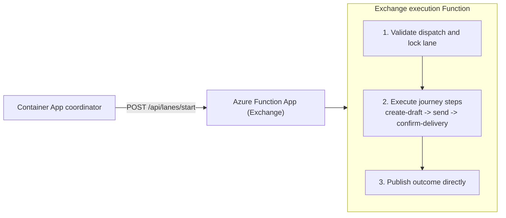

# Architecture (simple Exchange example)

This is the minimal runtime view: one coordinator Container App dispatching one
Exchange execution Function per selected case.

The coordinator only schedules and dispatches. It does not aggregate results.
The execution Function owns the journey run and publishes outcomes directly.
