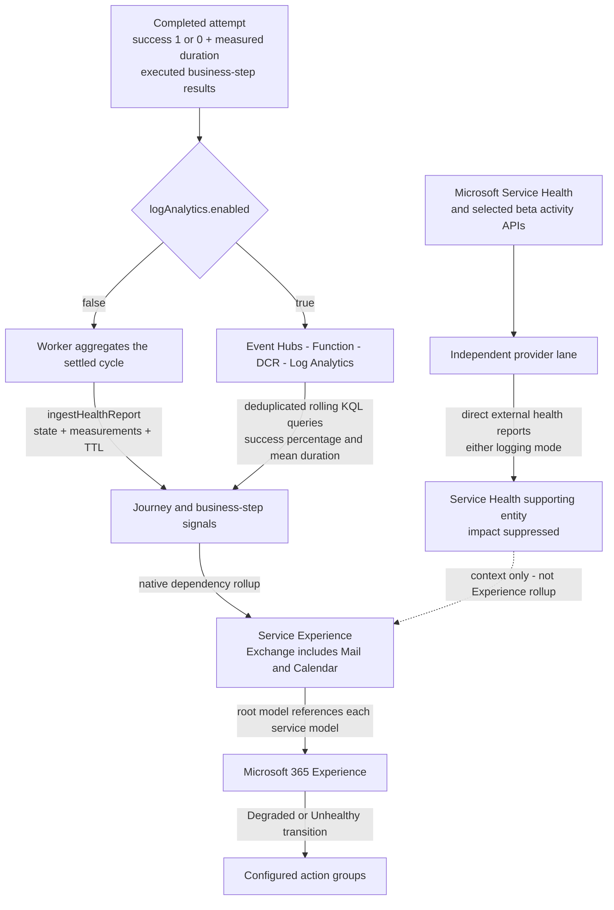
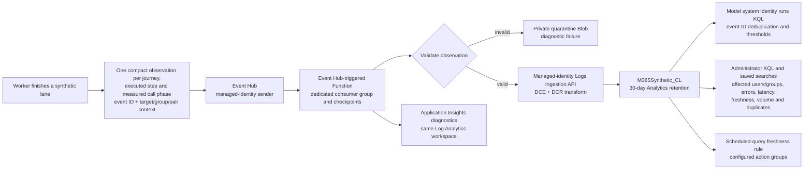

# Architecture and data flow

These diagrams describe the implemented resources, not a proposed platform.
The [root configuration](../monitoring.config.json) selects services, targets,
bot pairs, cadences, models and the single `logAnalytics.enabled` reporting toggle.
The checked-in configuration uses one tenant, three workers, two Teams bot pairs,
Log Analytics and Event Hubs Capture.

## 1. Actual services and their interactions

```mermaid
flowchart LR
    config["Root monitoring.config.json<br/>and generated .env IDs"] --> deploy["npm run deploy"]
    deploy --> acr["Azure Container Registry<br/>Basic - immutable worker image"]
    deploy --> blob["Azure Storage - private worker-config<br/>hash-addressed JSON snapshot"]
    acr --> workers
    blob -->|"managed-identity read and SHA-256 verification"| workers
    subgraph workers["Azure Container Apps - one Consumption environment"]
        exchange["Exchange worker<br/>one replica"]
        teams["Teams worker<br/>one replica - all bot pairs"]
        onedrive["OneDrive worker<br/>one replica"]
    end
    entra["Microsoft Entra ID<br/>explicit managed identities<br/>provider/readback federation"] -.-> workers
    exchange <-->|"mail and calendar APIs"| graph["Microsoft Graph"]
    onedrive <-->|"drive and file APIs"| graph
    teams <-->|"readback and meeting calls"| graph
    teams <-->|"bot posts and replies"| connector["Azure Bot Service F0 registrations<br/>Teams Bot Connector"]
    graph -->|"authenticated call notifications"| teams
    workers -->|"observations - logging on"| hub["Azure Event Hubs Standard"]
    hub --> consumer["Azure Functions Flex Consumption"]
    consumer --> ingestion["DCE and DCR<br/>Logs Ingestion API"]
    ingestion --> logs["Log Analytics Analytics table<br/>M365Synthetic_CL"]
    hub -.->|"optional Capture"| archive["Azure Storage - private capture archive"]
    consumer -.->|"invalid events"| quarantine["Azure Storage - private quarantine"]
    logs -->|"KQL - logging on"| models["Azure Monitor Health Models"]
    workers -->|"synthetic reports - logging off<br/>provider reports - either mode"| models
    models --> actions["Azure Monitor action groups<br/>operator-owned receivers"]
```

The configuration storage account also hosts Capture/quarantine containers when
logging is on. A separate storage account holds the Function's package, host state
and Event Hubs checkpoints. Checkpoints are transport state, not worker result
state. The bridge's Application Insights diagnostics use the workspace too.
Capture does not feed the live model; it provides an archive for operator-led replay.

Each service's provider lane runs inside its existing container, independently of
synthetic journeys. More accounts or bot pairs do not create more workers or
models. Teams bot registrations are identities/channel registrations, not extra
compute services; the existing Teams worker hosts their shared calling callback.

## 2. How the health model gets data



Direct mode evaluates the current settled cycle. Log Analytics mode evaluates a
rolling `healthModel.signalWindowMinutes` window, refreshed every minute. They
are intentionally different aggregations, not identical time series.

The topology is root model -> service model -> journey -> business step.
Exchange additionally groups journeys under Mail and Calendar. User-defined
Exchange/OneDrive groups are signal aggregation groups **within journey entities**,
not extra tenant/group models. Teams pairs contribute attempts to the same
journey entities; `Dimensions.botPairId` distinguishes their log records.
Authentication and compensating cleanup stay internal, while deliberate
deletion/call departure remain measured business steps.

Provider permissions, complete signal inventory and no-data semantics are in
[provider monitoring](./provider-monitoring.md). Timeouts are failed synthetic
attempts, not provider Unknown observations.

## 3. How Log Analytics works



`Value` is binary synthetic success; `Kind` separates journeys, steps and call
phases so queries do not combine unlike samples. `Timestamp` is observation time;
ingestion time alone does not establish fresh execution. Tenant, test target,
user/group and pair dimensions support investigation without a per-target model.
The [administrator guide](./operations.md#log-analytics-for-administrators) links the
five saved searches and describes the table.

The Function processes accepted observations; it does not execute probes.
Delivery/replay can duplicate records: model queries deduplicate event IDs, but
duplicate ingestion can still be billed. Stateless workers have no durable outbox,
so results lost before Event Hubs acceptance cannot be recovered from Capture.
The freshness rule shares the log pipeline's dependencies and is not an
out-of-band guarantee that alerting itself works.

## 4. Pricing and operational boundaries

See the [cost-driver diagram, assumptions and monthly estimates](./pricing.md).
Logging off removes the active optional ingestion path, but not worker/config
hosting or retained archive/history. Adding bot pairs increases Graph/Connector
requests and observations, not the fixed count of workers.

Before operational acceptance, independently verify execution progress, accepted
observations/reports, evaluated model state and notification delivery. Readiness
`/healthz`, a completed ARM rollout or an unexpired old report proves none of the
other stages. See [the reliability acceptance gate](./operations.md#enterprise-reliability-acceptance-gate).
