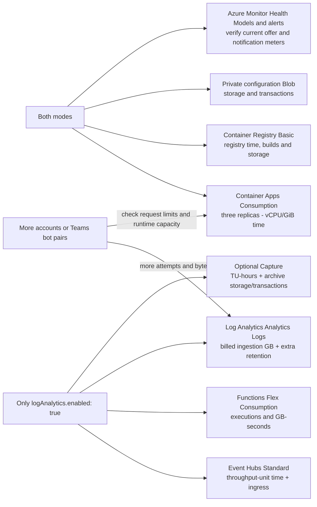

# Pricing and cost differences

The single `logAnalytics.enabled` toggle in
[monitoring.config.json](../monitoring.config.json) selects the reporting mode.
Set it to **false** for direct container health reports, or **true** for the
observation pipeline and KQL-backed model health.

These are **planning estimates, not an invoice or a service quote**. They use
October 2026 USD Central US list-price assumptions, 730 hours/month, and the
baseline configuration described below. Check your Azure agreement and regional prices before
committing a budget.

The following public retail meters were checked on **2026-10-30**, in USD for
`centralus`, using the [Azure Retail Prices API](https://prices.azure.com/api/retail/prices).
The estimates below still depend on workload assumptions, grants and actual billing.

| Configured component / public meter | Verified list rate |
| --- | ---: |
| Container Apps, Standard vCPU Active Usage | $0.000024/vCPU-second |
| Container Apps, Standard Memory Active Usage | $0.000003/GiB-second |
| Container Registry, Basic Registry Unit | $0.1666/day |
| Event Hubs, Standard Throughput Unit | $0.03/TU-hour |
| Event Hubs, Standard Ingress Events | $0.028/million billable events |
| Event Hubs, Standard Capture | $0.10/TU-hour |
| Log Analytics, Analytics Logs Data Ingestion, paid tier | $2.76/GB |

## Where costs come from



The [architecture diagrams](./architecture.md) connect each cost driver to its
actual data path. These subtotals are not a complete service quote.

## What changes with the toggle?

| | Log Analytics off | Log Analytics on |
| --- | --- | --- |
| Health reporting | Aggregated reports pushed directly from containers | Raw observations ingested; model health calculated with KQL |
| Aggregation | Current settled cycle; reports have a TTL | Rolling configured query window |
| Historical journey/user/group searches | No new log history; use console diagnostics and current model reports | Five administrator searches, per-attempt history and latency analysis |
| Event Hub, ingestion Function and DCR | Not used | Required |
| Raw event archive | No new Capture events | Optional Event Hubs Capture |
| Log-based freshness alert | Not available | Included in deployment; shares the workspace dependency |
| Worker/configuration hosting | Required | Required |

Turning logging off does **not** disable synthetic tests or direct model health.
It does remove historical log analysis and the log-based freshness watchdog.
Report expiry alone does not guarantee an Unhealthy state or a notification.

## Monthly planning subtotals

The following include the three existing service containers and one Basic
container registry. They exclude the separately listed items below and do not
deduct shared grants or negotiated discounts. Function and storage costs are
allowances, not measured invoices.

| Reporting configuration | Measured baseline: 4 Exchange, 2 OneDrive, one Teams pair | Projection: 100 Exchange + 100 OneDrive, baseline Teams |
| --- | ---: | ---: |
| **Log Analytics off: direct reports** | **About $65/month** | **About $65/month, subject to worker capacity** |
| Log Analytics on, Capture off | About $105-115/month | About $510-530/month |
| Log Analytics on, Capture on | About $180-190/month | About $590-610/month |

The baseline and all 100-account projections use **three workers, not one
worker per account**. The same 100 users may be targets for both Exchange and
OneDrive; this is not an assumption that 200 separate user identities are needed.

The projection holds worker CPU/memory, cadences, payload sizes and Event Hub
capacity constant. **It is not proof that the current sizing can execute 100
accounts within all deadlines.** Resource increases would change the subtotal.

For comparison with a budget that already pays for the workers/registry, the
**additional logging path** is approximately:

| Logging add-on only | Baseline targets | 100-account projection |
| --- | ---: | ---: |
| Capture off | $40-50/month | $445-465/month |
| Capture on | $115-125/month | $525-545/month |

Do not compare a logging-only estimate with a subtotal that also includes hosting.

### Additional Teams bot pairs

The measured baseline above predates the second configured pair; do not treat
its Log Analytics GB/month as a new two-pair measurement. Two pairs still use
one Teams container, the same registry, Event Hub and Function, so fixed hosting
does not double. At the configured 120-second cadence, another pair adds
2 channel attempts + 1 meeting attempt each cycle: **2,160 attempts/day**.
With all currently measured steps/call phases, that is 18 additional observation
events per cycle, or **12,960/day** before transport/ingestion diagnostics.

Marginal log ingestion is:
`additional observations x measured billed bytes per observation / 1e9 x regional GB rate`.
Re-measure `_BilledSize` after a change; no fixed per-pair log price is claimed.
The Azure Bot registrations use F0; verify
[Bot Service channel pricing](https://azure.microsoft.com/pricing/details/bot-services/)
and any channel-specific limits rather than assuming all future bot traffic is free.

## Cost components

### Always present: containers, registry and configuration

The checked-in configuration uses one Container App per tenant/service:
Exchange, Teams and OneDrive. Each has one replica, 0.25 vCPU and 0.5 GiB.

Using fully active Consumption rates of $0.000024/vCPU-second and
$0.000003/GiB-second:

```text
Per worker = 730 * 3,600 * (0.25 * 0.000024 + 0.5 * 0.000003)
           = $19.71/month
Three workers = $59.13/month
```

This is a fully active compute assumption. Actual active/idle billing, shared
Container Apps grants and discounts can reduce it. The published monthly grants
are shared per subscription, not awarded separately to each worker.

A Basic Azure Container Registry at about $0.167/day adds approximately
$5.08/month. Builds, additional image storage and transfer can add charges.

Private Blob configuration delivery remains in **both modes**. It is not a log
pipeline. Allow a small storage/transaction budget; the tables use approximately
$1/month for a small direct-only deployment rather than claiming storage is free.

### Only when on: Event Hubs

One Standard throughput unit at $0.03/hour is **$21.90/month**. This is a fixed
capacity cost while the namespace exists, even at low traffic.

Ingress-event charges are additional. Allow roughly $1/month at the current
volume and $5/month for the projected cohort; actual charges depend on the
current meter, message size and event count. More throughput units cost more.

### Only when on and selected: Capture

Standard Capture at $0.10/throughput-unit/hour adds **$73/month** for one TU,
plus Blob storage and transactions. It is an archive/replay feature, not a
requirement for KQL-backed model health.

The configured archive retention is 90 days. At steady state, archived storage
can approach three months of raw event volume; it is not the same measure as
Log Analytics billed bytes. Storage allowances in the subtotals are approximately
$1/month at the current scale and up to $10/month with Capture at the projected
scale. Validate them against actual archive growth.

**Disabling Capture is a larger saving than removing a few diagnostic log rows.**
It does not remove Event Hub capacity or Log Analytics ingestion charges.

### Only when on: Log Analytics

The planning ingestion rate is **$2.76/GB** for Analytics Logs. Billing GB means
**1,000,000,000 bytes**, not GiB.

The following extrapolate actual `_BilledSize` measurements from the steady-state
2026-10-30 00:25-00:40 UTC window. They include synthetic observations and ingestion
Function diagnostics, without the removed worker-side exporter data.

| | Measured baseline | 100-account projection |
| --- | ---: | ---: |
| Monthly billed data, 730-hour month | About 6.87 GB | About 151.02 GB |
| Ingestion before free allocation | **$18.96** | **$416.82** |
| If the entire shared 5 GB allocation is available | **$5.16** | **$403.02** |

The first 5 GB/month is shared **per billing account**, not per workspace,
container or tenant. It may already be consumed elsewhere. Its maximum saving at
the assumed rate is $13.80/month.

The projection scales Exchange measurements by 100/4 and OneDrive by 100/2,
leaving Teams unchanged. It holds observed Function diagnostic volume constant;
that volume may increase with throughput/instances. A 15-minute sample is not a
monthly billing guarantee: failures, retries, replay and payload changes affect it.
Duplicate ingested events are billed even when model queries deduplicate them.

The custom table is configured for 30-day retention, within the included Analytics
retention period. Longer retention, search jobs, exports or other plans/features
can add charges. Interactive Analytics queries within their included retention
period do not have a per-GB scan charge.

### Only when on: ingestion Function

The bridge uses Flex Consumption, 512 MB, without always-ready instances.
Execution count, duration and memory determine its compute bill; host/package
storage and Application Insights data are separate.

The subtotals allow **$0-5/month currently** and **$0-10/month at the projected
scale** for Function compute. These are allowances, not a guaranteed price.
Do not apply the legacy Consumption plan's grants/rates to Flex Consumption.
The linked Flex pricing page currently lists on-demand grants of 250,000
executions and 100,000 GB-s/month per eligible subscription; eligibility and
other applications' usage affect what remains available.

Function log/metric ingestion is already included in the Log Analytics estimate
above; do not add it a second time.

## What still costs money after switching off?

Deployment verifies direct reports, drains the previous pipeline and retires its
owned Event Hub, Function/plan, DCR/DCE, ingestion identity and log freshness rule.
This stops their active logging path and the Event Hub/Capture hourly capacity
charges. It is not merely a producer-side flag that leaves a billed Event Hub running.

Existing workspace history, Capture/quarantine archives, Function storage history
and configuration storage are retained. Historical Blob data still has storage
costs until it expires or an owner removes it. Extended workspace retention, if
separately enabled, can also continue to cost money. Off does not mean purge history.

## Exclusions and limits

- **Microsoft 365 licenses:** depend on your SKU, agreement and account design.
  Azure hosting estimates do not include them.
- **Azure Monitor Health Models and alerting:** no separate Health Models rate
  was verified for this guide. That is not a claim that the service is free.
  Check your offer and current pricing. Alert rules, action-group notifications,
  SMS/voice and independent watchdogs can have separate costs.
- **Other infrastructure:** network egress, private networking, DNS, Key Vault,
  extra storage/retention, additional tenants, replicas, regions and capacity changes.
- **Availability engineering:** these subtotals are not a budget for redundant
  execution, an out-of-band observer or an enterprise availability commitment.
- **No lossless guarantee:** stateless workers can lose unpublished results.
  Capture supports replay only for accepted events; it does not eliminate every gap.

## Check the estimate against actual usage

When logging is enabled, use the saved **Observation ingestion volume and duplicates**
search or [ingestion-volume.kql](../health-model/queries/admin/ingestion-volume.kql).
Use complete steady-state intervals and normalize `_IsBillable` case when summing
`_BilledSize`. Do not extrapolate old retained records as a current ingestion rate
after switching logging off.

Use Azure Cost Management to confirm billed meters, shared grants, discounts and
unexpected retained resources. Change the existing toggle/resource settings in
the root configuration and run `npm run deploy` from `synthetic-tests/`;
see [deployment](./deployment.md) and [operational acceptance](./operations.md).

## Microsoft pricing references

- [Container Apps pricing](https://azure.microsoft.com/pricing/details/container-apps/)
- [Container Registry pricing](https://azure.microsoft.com/pricing/details/container-registry/)
- [Event Hubs and Capture pricing](https://azure.microsoft.com/pricing/details/event-hubs/)
- [Azure Monitor pricing and shared free allocation](https://azure.microsoft.com/pricing/details/monitor/)
- [Log Analytics billing calculations and retention](https://learn.microsoft.com/azure/azure-monitor/logs/cost-logs)
- [Functions pricing: select Flex Consumption](https://azure.microsoft.com/pricing/details/functions/)
- [Blob Storage pricing](https://azure.microsoft.com/pricing/details/storage/blobs/)
- [Health Models overview](https://learn.microsoft.com/azure/azure-monitor/health-models/overview)
