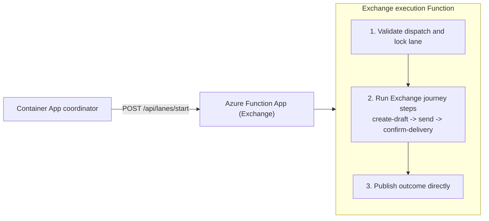

# Microsoft 365 synthetic tests

This Node project contains the journey runtime, Azure Function execution,
scheduled Container App dispatcher and deployment code for Exchange, Teams,
OneDrive and SharePoint Online. Setup/provisioning uses the PowerShell scripts
in [`setup/`](./setup/).

## Architecture (simple Exchange example)



This is the same pattern for the other services: coordinator dispatch only,
Function executes one case, Function publishes directly.

## Commands

Run from this [Node project directory](./).

| Command | Purpose |
| --- | --- |
| `npm run setup:ids` | Resolve and write generated IDs to `.env` beside root config |
| `npm run setup:reply-seeds` | Provision Exchange reply fixtures and write IDs to `.env` |
| `npm run onedrive:setup` | Print local OneDrive setup count/intent without changes |
| `npm run onedrive:setup -- -Apply -GrantTemporaryPermission` | Explicitly approve one-off folder provisioning with a transient setup-identity grant |
| `npm run setup:ids -- -SharePointOnly` | Discover existing SharePoint IDs in a disposable PowerShell job as the selected service identity |
| `npm run setup:function-auth` | Prepare secretless Function API/dispatcher authentication |
| `npm run deploy -- --plan` | Local deployment plan preview |
| `npm run deploy` | Deploy models, foundation, coordinator, and execution Functions |
| `npm run exchange -- --once` | Run one Exchange cycle |
| `npm run teams -- --once` | Run one Teams cycle |
| `npm run onedrive -- --once` | Run one OneDrive cycle |
| `npm run sharepoint -- --once` | Run selected SharePoint document/list lanes |
| `npm run typecheck` | TypeScript check |
| `npm run build` | Build project |

## Run one cycle

Live execution requires a host with the configured managed identity and approved
Microsoft 365 access. These commands exercise real resources in the checked-in
live profile, not a local simulation.

```sh
cd synthetic-tests
npm ci
npm run exchange -- --once
npm run teams -- --once
npm run onedrive -- --once
npm run sharepoint -- --once
```

Use `--tenant <alias>` when the config includes multiple tenants.
Live commands require `ENABLE_LIVE_M365=true` and approved resources/managed identities.
When Exchange/Teams beta activity is selected, also set
`ENABLE_BETA_SERVICE_ACTIVITY=true`.
The checked-in profile enables one approved SharePoint site/library/folder/list
target; execution-identity discovery and live acceptance are separate required checks.
Before recurrence, verify a complete real cycle, owned-artifact cleanup and
accepted reporting; successful local checks or process startup are not that proof.

## Configuration

- Root [monitoring.config.json](../monitoring.config.json) contains shared health/deployment settings and tenant inventory.
- Service settings are split into [monitoring.exchange.json](../monitoring.exchange.json), [monitoring.teams.json](../monitoring.teams.json), [monitoring.onedrive.json](../monitoring.onedrive.json), and [monitoring.sharepoint.json](../monitoring.sharepoint.json).
- [Generated IDs](../docs/deployment.md#generated-ids-in-env) are stored in its adjacent gitignored `.env`.
- Service selection, scenarios, execution, and deployment are composed from the root file plus the four service files.
- `logAnalytics.enabled` controls reporting path.
- `serviceHealth.enabled` controls provider context collection.
- All selected journeys run every 300 seconds with a 240-second whole-journey deadline; Exchange aligns to five-minute boundaries. Cleanup/reporting are separately bounded, and latency thresholds stay at 15/60 seconds.

## Services

- [Exchange](./exchange/README.md): health model, mailbox journeys, Graph endpoints and [setup](../docs/exchange-permissions.md)
- [Teams](./teams/README.md): health model, bot journeys, Graph/Connector endpoints and [setup](../docs/teams-permissions.md)
- [OneDrive](./onedrive/README.md): health model, file journeys, Graph endpoints and [setup](../docs/onedrive-permissions.md)
- [SharePoint Online](./sharepoint/README.md): health model, library/list journeys, Graph endpoints and [setup](../docs/sharepoint-permissions.md)
- [Shared runtime and deployment internals](./utils/README.md)
- [Hosting resources](./infra/README.md)

## Additional docs

- [Setup](../docs/setup.md)
- [Deployment details](../docs/deployment.md)
- [Operations](../docs/operations.md)
