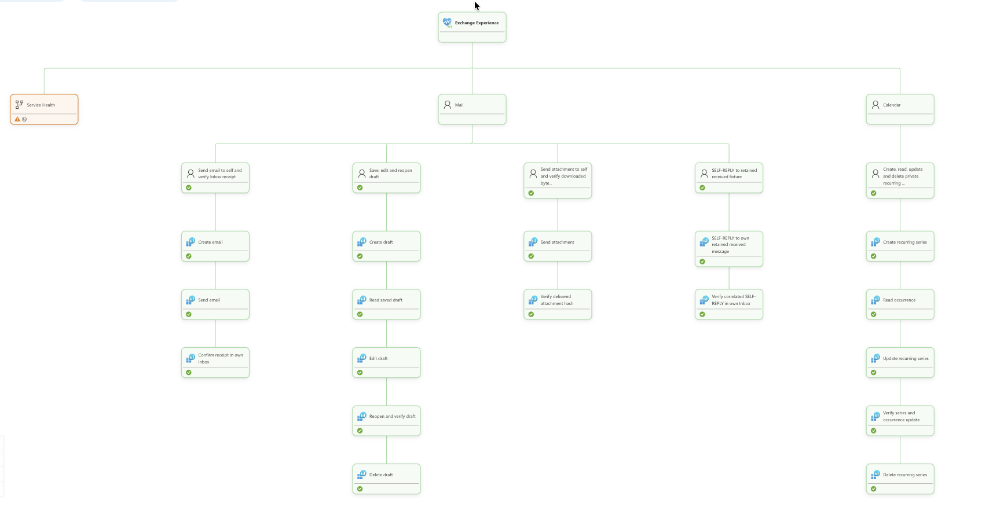

# Exchange synthetic journeys

Exchange journeys answer: **can a user send and receive their own test mail,
save work in a draft, retrieve an intact attachment, reply in the same
conversation and maintain a recurring appointment?** They use real Exchange
Online mailboxes through Microsoft Graph v1.0.



The model groups the first four journeys under **Mail** and recurrence under
**Calendar**. Business-step children show where a journey failed or slowed;
Microsoft-reported Service Health is separate, impact-suppressed context.

## User journeys and design choices

| Scenario | Completed journey | Why this check |
| --- | --- | --- |
| `send-receive-mail` | Create a draft, send to self and poll the same Inbox for the correlated delivery | Submission alone does not prove delivery; one mailbox avoids a second account dependency |
| `edit-reopen-draft` | Create, read, edit, reopen/verify and delete a draft | Checks saved state independently of mail transport |
| `attachment-mail` | Send an attachment to self, retrieve it and verify size and SHA-256 | Checks delivered content, not just a successful message response |
| `reply-mail` | Reply to a retained received self-addressed fixture; verify Inbox delivery, conversation and `In-Reply-To` | Isolates actual reply behavior without a second mailbox; fixture creation stays outside timed execution |
| `recurring-calendar` | Create a private three-occurrence series, expand occurrences, update/verify and delete it | Checks recurrence and update persistence without inviting or notifying people |

These are API-backed mailbox journeys, not Outlook UI checks or proof of
external-recipient delivery. Correlation and ownership checks restrict cleanup
to this attempt's artifacts; the retained reply fixture is not deleted.

## Graph endpoints

All paths are relative to `https://graph.microsoft.com/v1.0`; `{mailbox}` is
the configured mailbox. Queries filter correlation markers or occurrence windows.

| Method and path | Used for |
| --- | --- |
| `POST /users/{mailbox}/messages` | Create draft/self-mail, including the attachment payload |
| `GET /users/{mailbox}/messages` | Locate owned message copies for cleanup |
| `GET /users/{mailbox}/mailFolders/inbox/messages` | Verify delivery and locate self-replies |
| `GET /users/{mailbox}/mailFolders/inbox/messages/{messageId}` | Validate the retained received reply fixture |
| `GET`, `PATCH`, `DELETE /users/{mailbox}/messages/{messageId}` | Read/edit drafts and replies; remove owned copies |
| `POST /users/{mailbox}/messages/{messageId}/send` | Submit self-mail, attachment mail and reply drafts |
| `POST /users/{mailbox}/messages/{messageId}/createReply` | Create a reply to the retained fixture |
| `GET /users/{mailbox}/messages/{messageId}/attachments` | Locate the delivered attachment |
| `GET /users/{mailbox}/messages/{messageId}/attachments/{attachmentId}` | Read `contentBytes` for integrity verification |
| `POST`, `GET /users/{mailbox}/events` | Create the recurring series; reconcile an ambiguous create |
| `GET`, `PATCH`, `DELETE /users/{mailbox}/events/{eventId}` | Verify/update/delete the owned series |
| `GET /users/{mailbox}/events/{eventId}/instances` | Verify occurrence expansion and propagated edits |

Implementation: [mail steps](./src/steps.ts), [draft journey](./src/draft-journey.ts)
and [attachment/reply/calendar journeys](./src/extended-journeys.ts).

## Authentication and setup

The service's explicitly selected user-assigned managed identity authenticates
app-only for `https://graph.microsoft.com/.default`. Dedicated licensed users
own the mailboxes; their passwords and refresh tokens are not used.

| Exchange application RBAC role | Required by |
| --- | --- |
| `Application Mail.ReadWrite` | Mail/draft/attachment/reply operations and cleanup |
| `Application Mail.Send` | Sending journeys and reply-fixture provisioning |
| `Application Calendars.ReadWrite` | `recurring-calendar` only |

Scope those roles to approved test mailboxes. **Do not add tenant-wide Entra
`Mail.*` / `Calendars.*` application grants**: permissions are additive, so broad
grants defeat mailbox scoping.

Follow [Exchange account, authorization and fixture setup](../../docs/exchange-permissions.md).
Configure `tenants[].config` in [monitoring.exchange.json](../../monitoring.exchange.json):
`identity`, `targets.<groupId>.users[].mailbox`, `scenarios` and `execution`.
For `reply-mail`, run from [synthetic-tests/](../) after the shared Azure foundation:

```sh
npm run setup:reply-seeds
```

This launches a disposable PowerShell job as the Exchange identity and saves
generated fixture IDs in the gitignored `.env`.

## Optional provider endpoints

A **separate federated provider application**, not mailbox RBAC, authorizes:

| Graph GET path | Permission and purpose |
| --- | --- |
| `/v1.0/admin/serviceAnnouncement/healthOverviews` and `/v1.0/admin/serviceAnnouncement/issues` | `ServiceHealth.Read.All`; exact `Exchange Online` provider status/incidents |
| `/v1.0/admin/serviceAnnouncement/messages` | `ServiceMessage.Read.All`; Exchange Message Center announcements |
| `/beta/reports/serviceActivity/{function}(...)` | `ServiceActivity-Exchange.Read.All`; approved Exchange activity |

The nine beta functions are `getConnectivityMetricsForExchange`,
`getMessageVolumeMetricsForEmailDelivery`,
`getActiveUserMetricsForOutlookWebByReadEmail`,
`getActiveUserMetricsForOutlookWebByAppOpening`,
`getActiveUserMetricsForEmailByModernAuthentication`,
`getActiveUserMetricsForDesktopMailByReadEmail`,
`getActiveUserMetricsForOutlookMobileByReadEmail`,
`getActiveUserMetricsForOutlookMacByReadEmail` and
`getActiveUserMetricsForiOSOrAndroidMailByReadEmail`.
Connectivity is a provider percentage; the other metrics are counts, not
synthetic delivery-success rates.

See [provider setup and exact interval parameters](../../docs/provider-monitoring.md)
for consent, federation and live/beta gates. These tenant-wide read grants are
optional and independent of synthetic access. Results stay on
`exchange-service-health`, cannot change Experience rollup and report Unknown
when unavailable.

## Run and interpret

Hosted journeys execute in Azure Functions; the Container App dispatches cases
on the configured schedule. For a real one-cycle check on an Azure host with the
selected identity attached, use `ENABLE_LIVE_M365=true` and run:

```sh
npm run exchange -- --tenant <alias> --once
```

Also set `ENABLE_BETA_SERVICE_ACTIVITY=true` when beta provider collection is
selected, as in the checked-in profile.

The current config aligns all selected journeys/mailboxes every 300 seconds
with a 240-second complete-journey deadline. Cadence, request concurrency and
cleanup/reporting budgets come from `config.execution`; root latency thresholds
remain 15 seconds Degraded / 60 seconds Unhealthy. Genuine failures/deadline
expiry remain failures; worker cancellations and cleanup-only failures are
Unknown without numeric samples. Check step timings, sanitized Graph operation
errors, cleanup and accepted health reports using the
[operations runbook](../../docs/operations.md).
