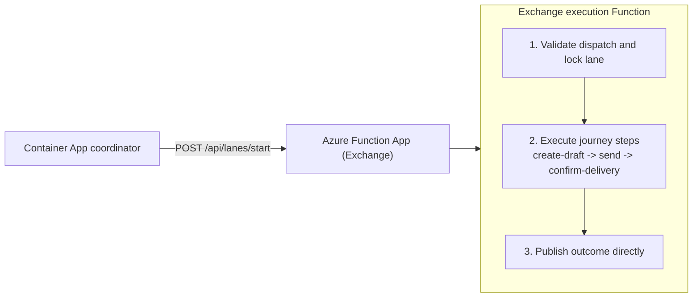

# Synthetic monitoring infrastructure

This folder contains Bicep templates for shared foundation resources, service-scoped execution Function apps, and the coordinator Container App.

## Architecture diagram



## What gets deployed

- One Function app per enabled service type (Exchange, Teams, OneDrive, SharePoint), shared across selected tenants
- One on-demand Flex Consumption plan per Function app, with no always-ready instances
- One watchdog Function app for independent execution/publication freshness monitoring
- One coordinator Container App that triggers per-case starts only (no aggregation path)
- Shared monitoring and diagnostics resources for Function hosting and direct reporting
- Explicit managed-identity and private configuration wiring consumed by runtime

The coordinator stays scheduled continuously; execution hosts can scale to zero
between work. Verify completed lane journals and fresh observations, not just
host Running status or HTTP 202 receipts. The watchdog checks every minute;
synthetic silence is flagged after 23 minutes with the current ten-minute cadence.

## Inputs

Deployment is fully driven by root [monitoring.config.json](../../monitoring.config.json),
service files (`monitoring.<service>.json`), and
[generated `.env` bindings](../../docs/deployment.md#generated-ids-in-env):

- resource group, region, and tags
- tenant/service enablement and schedules
- execution-Function identity references and app credential references
- Teams callback and bot pair settings when Teams is enabled
- SharePoint uses an existing approved managed identity, private ingress and the same configuration/reporting roles; Microsoft 365 permissions and site/library/list provisioning remain manual

## Deploy

From [synthetic-tests/](../):

```sh
npm run deploy -- --plan
npm run deploy
```

## Validate templates

```sh
az bicep build --file synthetic-tests/infra/main.bicep --stdout > /dev/null
```

## Related docs

- [Deployment flow](../../docs/deployment.md)
- [Runtime details](../utils/README.md)
