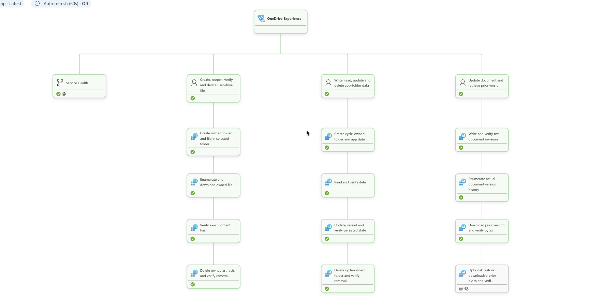

# OneDrive synthetic journeys

OneDrive journeys answer: **can a user save and reopen an intact file, can an
application persist its own data, and can an older document revision be
retrieved?** They use real personal OneDrive for Business drives through
Microsoft Graph v1.0. Shared site libraries/lists use the separate
[SharePoint service](../sharepoint/README.md).



Each journey rolls up its business-step measurements. **Service Health** is
separate supporting context. Exchange/OneDrive reporting groups aggregate
configured users' measurements without creating a health-model entity per user.

## User journeys and design choices

| Scenario | Completed journey | Why this check |
| --- | --- | --- |
| `user-drive-roundtrip` | Create a scratch folder/file beneath the approved folder, enumerate/download, verify exact content hash, delete and verify absence | Proves durable content and cleanup, not just upload acceptance; selected-folder grants limit normal access |
| `app-folder-lifecycle` | Resolve the app folder, write/read data, update/reread, delete the cycle-owned folder and verify removal | Exercises the separate application-data permission and persistence path |
| `document-versions` | Write/verify two revisions, enumerate actual history and download/verify prior bytes | Proves prior content exists and is retrievable, not just that version metadata was returned |

When `restoreVersion` is true, the last journey also writes the verified older
bytes back as current content and verifies them. This is a new content write,
**not** the server-side version-restore API. Scratch folders have per-attempt
ownership markers; cleanup never deletes the configured parent folder.
These checks do not measure browser UI or desktop sync-client behavior.

## Graph endpoints

All paths are relative to `https://graph.microsoft.com/v1.0`.

| Method and path | Used for |
| --- | --- |
| `GET /drives/{driveId}/items/{folderId}` | Verify the approved parent and owned artifact metadata |
| `POST /drives/{driveId}/items/{parentId}/children` | Create a cycle-owned child folder |
| `PUT /drives/{driveId}/items/{folderId}:/{fileName}:/content` | Write first/updated content and optional prior-byte rewrite |
| `GET /drives/{driveId}/items/{folderId}/children` | Enumerate the persisted file |
| `GET /drives/{driveId}/items/{fileId}/content` | Download and verify current bytes |
| `GET /users/{userId}/drive/special/approot` | Resolve the application's dedicated app folder |
| `GET /drives/{driveId}/items/{fileId}/versions` | Enumerate actual document history |
| `GET /drives/{driveId}/items/{fileId}/versions/{versionId}/content` | Retrieve and verify prior-version bytes |
| `GET /drives/{driveId}/items/{parentId}:/{folderName}` | Reconcile an ambiguous owned-folder creation |
| `DELETE /drives/{driveId}/items/{folderId}` | Delete the verified owned scratch folder; a read confirms absence |

Implementation: [journeys](./src/journey.ts),
[app-folder resolution](./src/steps.ts) and
[shared drive operations](../utils/src/integrations/drive-files.ts).

## Authentication and setup

The explicitly selected execution UAMI uses app-only
`https://graph.microsoft.com/.default` tokens. Licensed test users own drives;
their passwords and refresh tokens are not runtime credentials.

| Identity | Authorization |
| --- | --- |
| OneDrive execution UAMI | `Files.SelectedOperations.Selected` **plus** an explicit `write` grant on each dedicated folder for roundtrip/version journeys |
| Same UAMI, when app-folder journey is selected | Separately approved `Files.ReadWrite.AppFolder`; this is not constrained by the selected-folder grants |
| Separate one-off setup UAMI | Just-in-time `Files.ReadWrite.All` for provisioning; revoked after the tracked job |

We separate provisioning from execution so the continuously hosted identity
does not retain tenant-wide file-write authority. Consent to Selected permissions
alone grants no folder access; both approvals are necessary.

Follow [OneDrive accounts and permissions](../../docs/onedrive-permissions.md)
and [personal-drive/folder provisioning](../../docs/onedrive-setup.md).
In [monitoring.onedrive.json](../../monitoring.onedrive.json), each matching
`tenants[].config` selects `identity`, `targets.<groupId>.users[]` (UPN,
`folderName`, `restoreVersion`), `setup.identity`, scenarios and execution.
Personal drives must already be licensed and provisioned.

From [synthetic-tests/](../), under the approved administrator Azure CLI session:

```sh
npm run setup:ids
npm run onedrive:setup
# Only after explicit approval of the transient tenant-wide setup grant:
npm run onedrive:setup -- -Apply -GrantTemporaryPermission
```

The first setup plan is local intent/count only, not a Graph access test.
Applying launches a disposable managed-identity PowerShell job; it discovers
drives, creates/reuses folders, verifies grants and writes generated IDs to
`.env`. The helper removes its temporary Graph grant and reports cleanup failures
explicitly. Do not copy IDs manually into service configuration.

## Optional provider endpoints

A separately federated provider application can call these Graph GETs:

| Path | Permission and purpose |
| --- | --- |
| `/v1.0/admin/serviceAnnouncement/healthOverviews` | `ServiceHealth.Read.All`; overview ID `OneDriveForBusiness`, service `Microsoft OneDrive` |
| `/v1.0/admin/serviceAnnouncement/issues` | `ServiceHealth.Read.All`; exact OneDrive incident selection |
| `/v1.0/admin/serviceAnnouncement/messages` | `ServiceMessage.Read.All`; OneDrive Message Center announcements |

We use the overview **list** endpoint and distinguish OneDrive from SharePoint
Online; a SharePoint status is not a OneDrive substitute. OneDrive collects stable
context only, with no beta activity calls. See [provider setup](../../docs/provider-monitoring.md)
for separate tenant-wide consent and federation. Signals stay on
`onedrive-service-health`, cannot change synthetic/Experience rollup and report
Unknown when unavailable.

## Run and interpret

Hosted journeys run in the OneDrive Function app, dispatched by the Container App.
On an Azure host with the selected identity attached and
`ENABLE_LIVE_M365=true`, run:

```sh
npm run onedrive -- --tenant <alias> --once
```

Current service settings use independent 300-second lanes and a 240-second
whole-journey deadline. Cadence/budgets come from `config.execution`; latency
thresholds come from root health policy (15/60 seconds). Genuine failures and
deadline expiry remain failures; worker cancellations and cleanup-only failures
are Unknown without numeric samples. Verify current/prior bytes, cleanup,
sanitized Graph errors and accepted reports using [operations](../../docs/operations.md).
