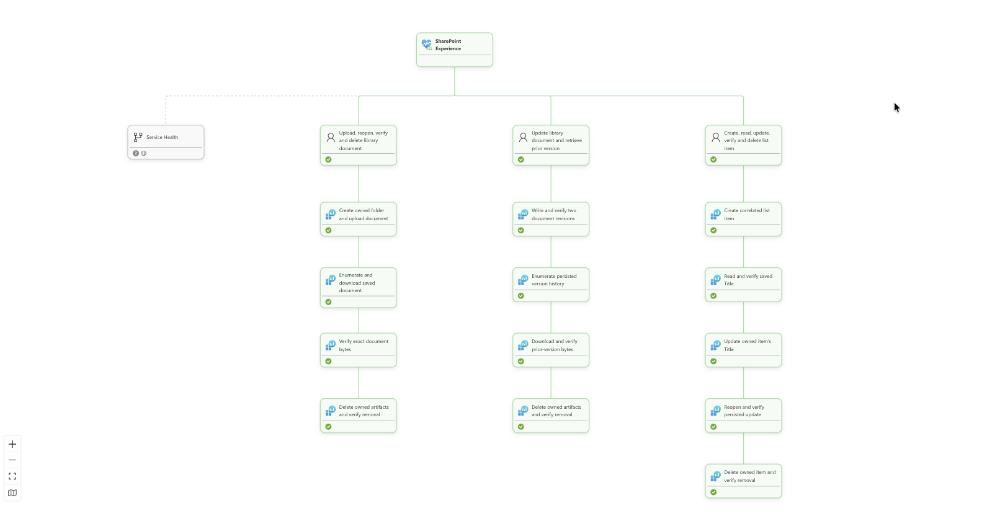

# SharePoint Online synthetic journeys

SharePoint journeys answer: **can a user save and reopen an intact library
document, retrieve its previous revision and maintain a list item?** The service
uses real approved SharePoint Online sites through Microsoft Graph v1.0,
independently of personal [OneDrive](../onedrive/README.md).



Each journey has business-step children so a library read, version retrieval
or list update can be distinguished. The suppressed **Service Health** branch
adds Microsoft-reported context without changing the Experience rollup.

## User journeys and design choices

| Scenario | Completed journey | Why this check |
| --- | --- | --- |
| `document-library-roundtrip` | Create scratch folder/document, enumerate/download, verify exact bytes, delete and verify absence | Confirms content persistence, not just a successful upload status |
| `document-versions` | Write/verify two revisions, enumerate history, download/verify the prior revision and clean up | Confirms actual older bytes are retrievable, not merely a version count |
| `list-item-lifecycle` | Create an item, read its Title, update, reopen/verify, delete and confirm absence | Separately exercises structured list persistence and updates |

Dedicated fixtures keep synthetic writes away from business documents. Site,
library and list bindings are checked before mutation; per-attempt correlation,
parent and name checks protect cleanup. Only owned scratch artifacts are removed,
never the configured folder, library, list or site. Files enter the recycle bin;
there is no permanent purge. These API checks do not measure employee browser,
search, sharing or coauthoring experience.

## Authentication and setup

The explicitly selected same-tenant execution UAMI obtains app-only Graph tokens
for `https://graph.microsoft.com/.default`. It needs **both** Graph application
`Sites.Selected` consent and an administrator-approved `write` assignment on the
chosen site. Consent alone grants no site access. The boundary is the **whole
selected site**, not only the configured folder/list; runtime ownership checks
do not narrow permission scope.

Follow [SharePoint site, authorization and discovery setup](../../docs/sharepoint-permissions.md).
An administrator prepares an existing site, version-enabled library, dedicated
direct-child folder and ordinary list with `Title`. Checkout, approval, required
fields and retention must permit the approved operations.

In [monitoring.sharepoint.json](../../monitoring.sharepoint.json), the matching
`tenants[].config` selects `identity` and ungrouped `targets[]` with `siteUrl`,
`libraryName`, `folderName`, `listName`. Use location names, not generated IDs.
After the shared Azure foundation, run from [synthetic-tests/](../) with the
approved operator Azure CLI session:

```powershell
npm run setup:ids -- -SharePointOnly
# Multiple tenants: add -Tenant <alias>
```

The helper launches read-only PowerShell discovery in a disposable job using
**only the selected SharePoint UAMI for Graph**. It creates no sites, libraries,
folders, lists or Graph grants and writes `SITE_ID`, `DRIVE_ID`, `FOLDER_ID` and
`LIST_ID` to the adjacent gitignored `.env`. The operator authorizes Azure job
orchestration, not a broader Graph discovery credential. There is no user-password,
secret, certificate or administrator-token fallback inside discovery/runtime.

## API reference

All paths below are relative to `https://graph.microsoft.com/v1.0`.
Microsoft's [Selected permissions model](https://learn.microsoft.com/en-us/graph/permissions-selected-overview)
authorizes these operations on the assigned site; endpoint permission tables
also describe broader permissions, which this worker does not request.

| Operation | Exact path |
| --- | --- |
| [Resolve site](https://learn.microsoft.com/en-us/graph/api/site-getbypath?view=graph-rest-1.0), verify binding | `GET /sites/{hostname}:/{site-path}`, `GET /sites/{site-id}` |
| [Libraries](https://learn.microsoft.com/en-us/graph/api/drive-list?view=graph-rest-1.0), existing folder | `GET /sites/{site-id}/drives`, `GET /drives/{drive-id}/root:/{folder-name}` |
| [Create folder](https://learn.microsoft.com/en-us/graph/api/driveitem-post-children?view=graph-rest-1.0), enumerate | `POST /drives/{drive-id}/items/{parent-id}/children`, `GET /drives/{drive-id}/items/{item-id}/children` |
| [Upload/update](https://learn.microsoft.com/en-us/graph/api/driveitem-put-content?view=graph-rest-1.0), [download](https://learn.microsoft.com/en-us/graph/api/driveitem-get-content?view=graph-rest-1.0) | `PUT /drives/{drive-id}/items/{parent-id}:/{filename}:/content`, `GET /drives/{drive-id}/items/{item-id}/content` |
| [Versions](https://learn.microsoft.com/en-us/graph/api/driveitem-list-versions?view=graph-rest-1.0), [prior bytes](https://learn.microsoft.com/en-us/graph/api/driveitemversion-get-contents?view=graph-rest-1.0) | `GET /drives/{drive-id}/items/{item-id}/versions`, `GET /drives/{drive-id}/items/{item-id}/versions/{version-id}/content` |
| [Verify/delete artifacts](https://learn.microsoft.com/en-us/graph/api/driveitem-delete?view=graph-rest-1.0) | `GET`, `DELETE /drives/{drive-id}/items/{item-id}` |
| [Lists](https://learn.microsoft.com/en-us/graph/api/list-list?view=graph-rest-1.0) | `GET /sites/{site-id}/lists`, `GET /sites/{site-id}/lists/{list-id}` |
| [Create item](https://learn.microsoft.com/en-us/graph/api/listitem-create?view=graph-rest-1.0) | `POST /sites/{site-id}/lists/{list-id}/items` |
| [Read/delete item](https://learn.microsoft.com/en-us/graph/api/listitem-get?view=graph-rest-1.0) | `GET`, `DELETE /sites/{site-id}/lists/{list-id}/items/{item-id}` |
| [Update fields](https://learn.microsoft.com/en-us/graph/api/listitem-update?view=graph-rest-1.0) | `PATCH /sites/{site-id}/lists/{list-id}/items/{item-id}/fields` |

Site-by-path and list enumeration are setup discovery calls; pinned site,
library/folder and list verification also occurs at runtime. Implementation:
[binding checks](./src/targets.ts), [document journeys](./src/document-journey.ts)
and [list steps](./src/list-steps.ts).

## Optional provider endpoints

A separate federated provider application can call these Graph GETs:

| Path | Permission and purpose |
| --- | --- |
| `/v1.0/admin/serviceAnnouncement/healthOverviews` | `ServiceHealth.Read.All`; overview ID `SharePoint`, service `SharePoint Online` |
| `/v1.0/admin/serviceAnnouncement/issues` | `ServiceHealth.Read.All`; exact SharePoint incident selection |
| `/v1.0/admin/serviceAnnouncement/messages` | `ServiceMessage.Read.All`; SharePoint Message Center announcements |

This is distinct from OneDrive's provider status and is not authorized by
`Sites.Selected`. SharePoint collects stable context only, with no beta activity
calls. Follow [provider consent and federation](../../docs/provider-monitoring.md)
for these optional tenant-wide read grants. All signals stay on
`sharepoint-service-health`; unavailable data is Unknown and cannot change
synthetic results or Experience rollup.

## Run and interpret

Hosted journeys execute in the SharePoint Function app; the Container App only
dispatches scheduled cases. For a real one-cycle check on an Azure host with the
selected identity attached and `ENABLE_LIVE_M365=true`, run:

```sh
npm run sharepoint -- --tenant <alias> --once
```

Current `config.execution` selects independent document/version/list lanes at
300 seconds with 240-second whole-journey deadlines and separate cleanup/report
budgets; root latency thresholds remain 15/60 seconds. Genuine failures/deadline
expiry are failures. Worker cancellations and cleanup-only failures are Unknown
without numeric samples, preserving successful business steps. Verify actual
bytes, prior revisions, fields, cleanup and accepted reports using
[operations](../../docs/operations.md).
