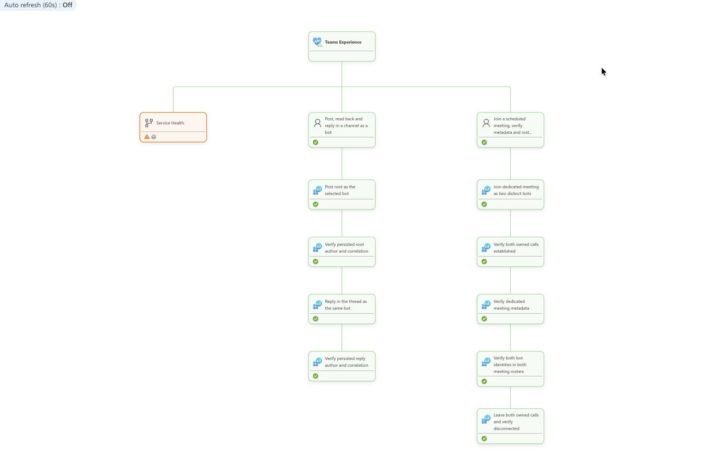

# Teams synthetic journeys

Teams journeys answer: **can a bot post and read a channel conversation, and can
two distinct bots join, verify and leave the same scheduled meeting?** Bot-only
participants make these checks unattended without human answers, delegated
sign-in or refresh-token maintenance.



Each journey has its own business-step children. The **Service Health** branch
is Microsoft-reported context, suppressed from the Teams Experience rollup.

## User journeys and design choices

| Scenario | Completed journey | Why this check |
| --- | --- | --- |
| `channel-conversation` | Primary bot posts a root, Graph verifies author/correlation, the same bot replies, Graph verifies the persisted reply | Bot Connector is used for app-only posting; independent Graph readback proves storage rather than trusting a send response |
| `scheduled-meeting` | Both bots join a pre-created meeting, establish both calls, verify organizer/thread metadata and both rosters, leave and confirm disconnection | Two identities prove shared meeting connectivity; a pre-created fixture avoids meeting-creation permissions |

Every configured pair exercises every selected channel and meeting. A licensed
organizer prepares the meeting but is not a probe participant. Service-hosted
media avoids processing audio; established calls and rosters do **not** prove
received audio, call quality or the employee Teams client experience.

## APIs used

Graph paths are relative to `https://graph.microsoft.com/v1.0`:

| Method and path | Credential and purpose |
| --- | --- |
| `GET /teams/{teamId}/channels/{channelId}/messages` | Federated readback app verifies persisted root author/correlation |
| `GET /teams/{teamId}/channels/{channelId}/messages/{messageId}/replies` | Same app verifies the threaded reply |
| `POST /communications/calls` | Each bot identity joins the existing scheduled meeting |
| `GET /communications/calls/{callId}` | Owning bot checks established/terminated state and meeting metadata |
| `GET /communications/calls/{callId}/participants` | Each bot verifies both participant identities in its roster |
| `DELETE /communications/calls/{callId}` | Owning bot leaves; subsequent reads confirm departure |

Posting is **Bot Connector, not Graph**, relative to the configured validated
service URL (default `https://smba.trafficmanager.net/teams/`):

| Method and path | Purpose |
| --- | --- |
| `POST v3/conversations` | Primary bot creates the channel root post |
| `POST v3/conversations/{conversationId}/activities/{rootActivityId}` | Same primary bot posts the reply |
| `DELETE v3/conversations/{conversationId}/activities/{activityId}` | Remove owned posts/replies when `teamsCleanupEnabled` is true |

The checked-in configuration retains channel messages (`teamsCleanupEnabled:
false`); approve retention and traffic accordingly. Meeting legs are still
torn down. Implementation: [conversation](./src/conversation.ts),
[calling](./src/call.ts) and [Bot Connector client](../utils/src/integrations/teams.ts).

## Authentication and setup

| Identity/application | Required authorization |
| --- | --- |
| Each primary/peer bot UAMI | Azure Bot `UserAssignedMSI` registration and Teams channel; calling configuration when selected |
| Each primary bot's installed Teams app | Installation in each selected team; application RSC `ChannelMessage.Read.Group` for the separate readback app |
| Teams execution UAMI | Federated credential on `execution.teamsReadbackClientId` for secretless Graph readback |
| Every bot joining meetings | Graph application `Calls.JoinGroupCall.All`, separately approved on each bot identity |

Readback is scoped to the consented **team**, not just the configured channel.
Calling consent is tenant-wide, not meeting-scoped. No `CallRecords.Read.All`,
`OnlineMeetings.ReadWrite.All` or `Calls.AccessMedia.All` is needed for these flows.
Graph tokens use `https://graph.microsoft.com/.default`; Bot Connector uses
`https://api.botframework.com/.default`.

Follow [Teams bot, app, readback and meeting setup](../../docs/teams-permissions.md).
Set `identity`, `botPairs`, ungrouped `targets`, `callTargets` and `execution` in
the matching `tenants[].config` of [monitoring.teams.json](../../monitoring.teams.json).
After foundation deployment, run from [synthetic-tests/](../):

```sh
npm run setup:ids
```

The helper resolves channel IDs, both bot IDs, organizer IDs and the actual
Teams **Function** callback URL in `.env`. Configure that public `/api/calls`
URL on every calling bot; the handler validates signed Graph notifications.
Creating an app package, consenting RSC and approving calling remain explicit
administrator actions.

## Optional provider endpoints

A separately federated provider app authorizes these Graph GETs:

| Path | Permission and purpose |
| --- | --- |
| `/v1.0/admin/serviceAnnouncement/healthOverviews` and `/v1.0/admin/serviceAnnouncement/issues` | `ServiceHealth.Read.All`; exact `Microsoft Teams` status/incidents |
| `/v1.0/admin/serviceAnnouncement/messages` | `ServiceMessage.Read.All`; Teams Message Center announcements |
| `/beta/reports/serviceActivity/{function}(...)` | `ServiceActivity-Teams.Read.All`; approved Teams activity |

The five beta functions are `getUsageMetricsForTeamsByMeetingsJoined`,
`getUsageMetricsForTeamsByLaunch`, `getMessageVolumeMetricsForTeamsChat`,
`getAudioStreamQoEMetricsForTeams` and `getAudioStreamsOverUdpMetricsForTeams`.
Join/launch/chat counts are not success rates. QoE is telemetry **coverage**, not
audio quality; UDP percentage is transport context.

See [provider consent, federation and exact interval parameters](../../docs/provider-monitoring.md).
These optional tenant-wide read grants are independent of bot/RSC permissions.
All provider signals stay on `teams-service-health`; missing data is Unknown and
cannot change journey success or Experience rollup.

## Run and interpret

Hosted execution and callbacks run in the Teams Function app; the Container App
only dispatches scheduled cases. For a real one-cycle check, use an Azure host
with every configured identity attached and `ENABLE_LIVE_M365=true`:

```sh
npm run teams -- --tenant <alias> --once
```

Also set `ENABLE_BETA_SERVICE_ACTIVITY=true` when beta provider collection is
selected, as in the checked-in profile.

Current configuration selects a 600-second cadence and 240-second whole-journey
deadline, with separately bounded cleanup/reporting. Cadence and budgets come
from `config.execution`. The root
[journey latency override](../../health-model/README.md#latency-thresholds) uses
30 seconds Degraded / 60 seconds Unhealthy for channel conversation and its
business steps. Scheduled meetings retain the global 15/60-second defaults.
Cancellations and cleanup-only failures are Unknown, not invented failed
business departures. Check Function callback diagnostics, both call legs,
retained/cleaned posts and accepted reports using [operations](../../docs/operations.md).
